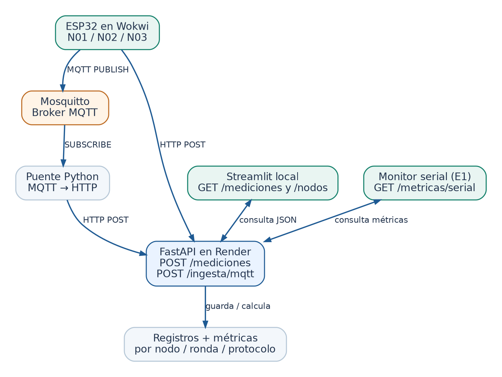

# Backend del docente · Receta de instalación y prueba



**Lee el esquema de arriba:** el ESP32 envía por HTTP a Render o por MQTT a Mosquitto. El puente docente lleva las publicaciones MQTT a Render; Streamlit consulta la API.

**Qué contiene:** `api/` recibe HTTP y consulta datos; `mosquitto.conf` configura el broker MQTT; `puente.py` reenvía MQTT a la API; `compose.yaml` levanta el entorno; `render.yaml` despliega la API. **No hay claves HTTP ni MQTT.** Solo usar datos ficticios y servidores temporales, nunca servicios de producción.

## A. Comprueba el backend en tu computador

1. Instala **Docker Desktop** y abre una terminal en esta carpeta `BACKEND`.
2. Ejecuta:

   ```bash
   docker compose up -d --build
   ```

3. En el navegador abre `http://127.0.0.1:8000/salud`. Debe salir `{"estado":"ok"}`.
4. Abre `http://127.0.0.1:8000/docs`. Para probar HTTP, abre `POST /mediciones` → **Try it out** e introduce:

   ```json
   {"experimento":"lab2026","nodo_id":"N01","zona":"exterior","ronda":"R01","secuencia":1,"temperatura_c":24.5,"humedad_pct":60.0}
   ```

   Pulsa **Execute**. Debe devolver `201`.
5. Abre `http://127.0.0.1:8000/metricas/serial?experimento=lab2026&nodo_id=N01&ronda=R01`. Debe indicar **HTTP: 1 recibidas**.
6. Prueba MQTT sin Wokwi, desde otra terminal (con Docker encendido):

   ```bash
   docker compose exec broker mosquitto_pub -h localhost -p 1883 -t doctorado/lab2026/N02/telemetria -m '{"experimento":"lab2026","nodo_id":"N02","zona":"interior","ronda":"R01","secuencia":1,"temperatura_c":26.2,"humedad_pct":54.0}'
   ```

7. Abre `http://127.0.0.1:8000/metricas/serial?experimento=lab2026&nodo_id=N02&ronda=R01`. Debe indicar **MQTT: 1 recibidas**. Si no, revisa `docker compose logs --tail=40 puente`.

**Ya está probado el flujo** API + broker + puente cuando HTTP y MQTT aparecen en estas métricas.

## B. Publica la API HTTP en Render

1. Sube **el contenido de `BACKEND`** a un repositorio Git; no subas `datos/` ni archivos `.db`.
2. En Render, crea un **Web Service** conectado al repositorio:
   - Build: `pip install -r requirements.txt`
   - Start: `uvicorn api.main:app --host 0.0.0.0 --port $PORT`
   - Health check: `/salud`
3. Sin `DATABASE_URL`, utiliza **SQLite temporal**: sirve para ensayo, pero los datos **se pierden si Render reinicia o recrea el servicio**. Para conservar datos, crea una base PostgreSQL y agrega su URL interna en la variable `DATABASE_URL` del servicio (configuración solo docente; no compartir). No se exige esto para una primera prueba.
4. Comprueba `https://TU-API.onrender.com/salud` y `/docs`.

## C. Haz que el broker público reenvíe a Render

El ESP32 Wokwi debe acceder al broker MQTT por Internet. La API de Render **no reemplaza** al broker TCP MQTT.

1. Ejecuta Mosquitto + puente en un VPS de ensayo con Docker. En `BACKEND`, crea un archivo `.env` con **una sola línea**:

   ```text
   API_URL=https://TU-API.onrender.com
   ```

2. Ejecuta `docker compose up -d --build`. El puente leerá esa URL; el broker usa el puerto **1883/TCP**. Comprueba que ese puerto no está ya ocupado, y habilítalo temporalmente en el cortafuegos si corresponde.
3. En los `.ino` de Wokwi, coloca `MQTT_HOST` = IP o dominio público del VPS, **sin** `mqtt://`; `API_BASE` = URL HTTPS de Render. Usa el mismo `EXPERIMENTO` para todos.
4. Antes de clase, prueba **N01 por HTTP y N02 por MQTT**, verificando `/metricas/serial` para cada nodo.

## Si algo falla

| Síntoma | Revisa |
|---|---|
| `/salud` no abre | `docker compose logs --tail=40 api` |
| MQTT publica pero no llega a API | `docker compose logs --tail=40 puente` y el valor `API_URL` |
| Wokwi no se conecta | `MQTT_HOST`, puerto 1883, cortafuegos y pasarela de Wokwi |
| Métricas muestran 0 | `EXPERIMENTO`, `RONDA`, `NODO_ID` y espera unos segundos |
| Hay mensajes repetidos | La API solo cuenta una vez cada `(experimento,nodo,ronda,protocolo,secuencia)` |

**Precaución:** API y broker no piden contraseñas. Son intencionalmente públicos para simplificar **este ensayo temporal**, por lo que terceros podrían enviar datos falsos. No uses información privada, no expongas bases de datos de otros proyectos, y detén el broker con `docker compose down` al terminar. No dejes el puerto 1883 abierto permanentemente. Las métricas de bytes son estimaciones a nivel de aplicación, no mediciones de red o de energía.

## Identificadores con nombre (actualización de esta versión)

Después de actualizar Render con este backend, acepta `N01_ana`, `N02_pedro`, `N03_luis` y también `N01`, `N02`, `N03` antiguos. No se modifica ninguna ruta ni la estructura de la base. El nombre va dentro de `nodo_id`, por lo que métricas, consultas y tópicos MQTT se separan automáticamente.

Para probarlo: abre `/docs` y manda el mismo JSON del Ejercicio 1 con `"nodo_id": "N01_ana"`. Debe responder `201`, no `422`. Usa nombres en minúsculas sin tildes ni espacios (entre 2 y 20 caracteres).
